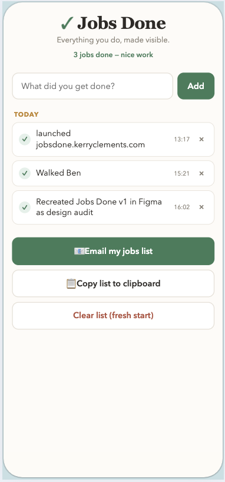

# ✓ Jobs Done

**Everything you do, made visible.**

A tiny, dependency-free web app for logging the jobs you get through in a day — and sharing the list with your family in one tap.

## The story

So much of the work that keeps a household running is invisible: laundry, floors, school snacks, feeding the dog, the hundred small things that happen quietly in the background. Jobs Done makes that work visible. You log each job as you do it, then send the day's list to your family group chat or inbox — not as score-keeping, but as sharing.

It started as a brainstorming conversation with Claude (Anthropic's AI assistant) about the overwhelm of unseen daily work, and how to log it _simply_ — no set-up, no accounts, no app installs. The idea, the framing, and the design direction came from that conversation; Claude acted as a sounding board and pair-programmer to build it. It was in real family use within hours.

It was built for busy parents (by a busy mum) who wanted a frictionless way to say _"here's what my day looked like."_

📖 Read the full [case study](CASE_STUDY.md) — the story, design decisions, and learnings behind the app.

## Features

- **One-line logging** — type a job, press Enter, done. Each entry is timestamped automatically.
- **Day grouping** — jobs are grouped under Today / Yesterday / weekday headings.
- **Share anywhere** — one button opens a pre-filled email (`mailto:`); another copies a neatly formatted list to the clipboard, perfect for WhatsApp.
- **Accidental-close protection** — if there are unsent jobs on the list, the browser warns before the tab closes.
- **Storage-aware** — when run inside an environment that provides a persistent key-value store (`window.storage`), the list survives between sessions. In a plain browser tab it gracefully degrades to in-page memory, with the close warning as the safety net.
- **Zero dependencies** — a single HTML file. No frameworks, no build step, no install. Open it and go.

## Tech

- Vanilla HTML, CSS, and JavaScript in one file
- No external libraries or network calls
- Accessible touches: focus styles, `aria-label`s on icon buttons, `prefers-reduced-motion` respected

## Run it

Open `index.html` in any browser. That's it.

Or try the live demo via GitHub Pages: _(enable Pages in repo settings → link appears here)_

## Design decisions

- **Single file, no framework.** The app is small enough that a framework would be pure overhead; vanilla JS keeps it instantly portable and easy to read.
- **Graceful degradation over hard dependency.** Rather than requiring a backend or browser storage, the app detects what's available and adapts, warning the user before data could be lost.
- **`mailto:` + clipboard instead of an email API.** Sharing goes through apps the user already trusts, so there are no accounts, keys, or privacy concerns.

## Roadmap

- [ ] Optional localStorage persistence for plain-browser use
- [ ] Style themes
- [ ] Weekly summary view
- [ ] PWA install (add to home screen)

## Licence

MIT — use it, fork it, share it with your family.
